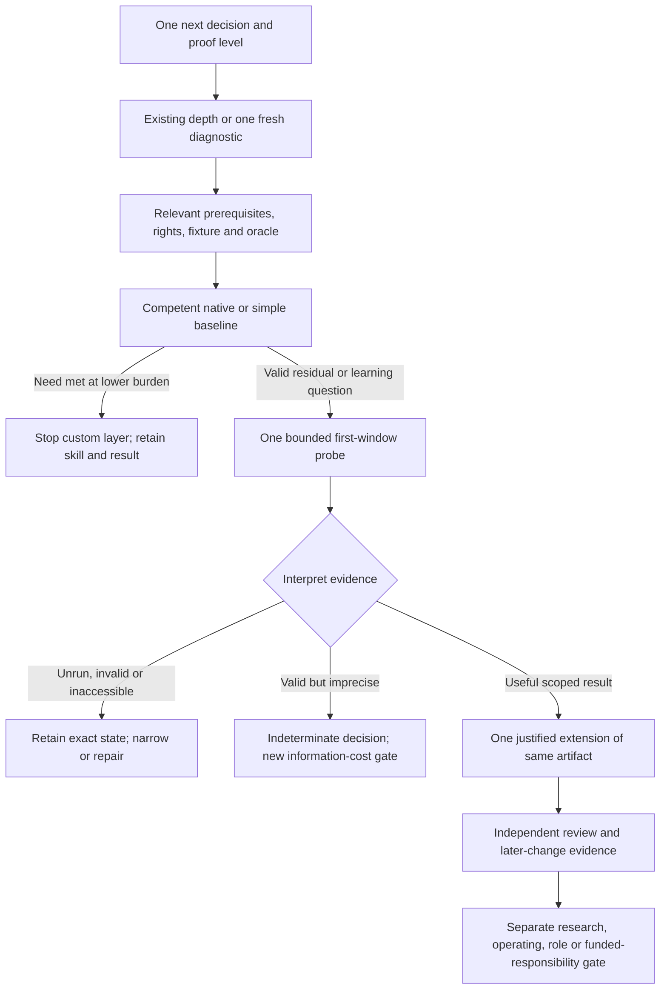

# One-probe exploration router

Draft decision specification, 20 October 2026. This connects the eight work bundles to the existing preparation DAG, experiment policy, six transfer bridges, root-reviewed reading slices and ownership evidence. It does **not** choose a field or assess this person. Starting competence, time, preferences, rights and resources remain unknown, so no actual probe is selected. The intended output, once a next decision and admissible evidence exist, is **one active bounded project**, with at most one conditional extension.

The JSON uses exact document/record/field pointers and hashes. It references the guarded staged DAG and selection policy; their originals remain frozen. This preserves the completed-valid-but-imprecise rule and research route's explicit one-method gate. Root's learning-round21 decision accepts narrow reading/design clarifications, not completed learning or module depth. Round18 work bundles remain under independent review; this router neither edits nor accepts that draft. Current claim interpretation comes from `claim-register-context-round21.json`.

## Branch on evidence, not field labels

These are proposed branching questions for a later decision, not questions being asked or tests being administered now.

| Branch | Observable evidence | Route when evidence is missing or adverse |
|---|---|---|
| **What one next commitment would this result change?** | A concrete task question, intended proof level and alternative use of the same effort. | Leave fields unranked. A source/contract inspection can clarify feasibility without pretending to select a career. |
| **What does the intended conclusion require?** | Learning, finite implementation, research, authorized operation, exact role access or recurring commercial value explicitly distinguished. | Narrow to the available proof. A data fixture cannot establish clinical benefit; a public role cannot establish personal eligibility. |
| **What depth is already demonstrated?** | Actual executed work, independent expected results, complete failure/assistance records and a fresh mechanism explanation. | Choose one relevant diagnostic from the existing DAG. A title or proposed artifact proves neither mastery nor a beginner deficit. Skip reading already justified by evidence. |
| **What prerequisites belong to this narrow claim?** | Appropriate module depth and hard dependencies; one substantive method if claiming research-design depth. | Do not load every prerequisite or all four research methods. A smaller paper/source diagnostic can proceed while broader depth stays unknown. |
| **Can one lawful fixture reach an approved reference/runtime?** | Exact rights/source identity, an actual record/label fixture, compatible resources and the access required for the claim. | Stay at source/manifest/design level or choose a valid lower-dependency arm. At the cap, stop inaccessible execution; do not diagnose inability. |
| **Can the oracle distinguish correct, plausible-wrong and unknown?** | Expected answers fixed first, crosschecked reference, positive/negative/ambiguous cases and correct units/dependence. For assessment, genuinely unexposed material and learner. | Repair measurement or call the work unblinded practice. Hidden does not mean correct; an independent scorer does not make a learner's known answer unseen. |
| **Does a competent native/simple alternative already meet the contract?** | Matched inputs, information cuts, quality/coverage/authority and full setup/review/failure/maintenance burden. | Record native effectiveness as untested when access is absent. A valid native win stops the custom/model/product layer, while preserving learning. |
| **Which single experiment is informative within the chosen existing cap?** | One project/question, one source budget, actual available effort and a pairwise alternative with comparable proof. | Keep incomparable choices unranked. Reading, setup, a bridge screen and repair consume this same ledger. No silent increase or parallel eight-track curriculum. |
| **What result was actually obtained?** | All attempts, failures, effort, uncertainty and proof scope retained. | Distinguish unrun, invalid, inaccessible, baseline win, scoped improvement and valid-but-imprecise. Neither a losing change nor an invalid checker rejects a person/field. |
| **Is one later question worth the remaining commitment?** | A valid result changes the next decision; a new oracle/access path and remaining opportunity cost are explicit. | Retain the scoped result. No obligation to fill ninety days; more measurement needs a fresh bounded decision. |
| **What supports original contribution or accountable scope?** | Independent technical/domain scrutiny, a legitimate receiving need, sustained maintenance and—when claimed—real funded responsibility. | Retain finite proof and a prepared handoff. Elapsed years, certificates or public contacts do not supply entrusted scope. |

## Eight alternative terminals

Each terminal reuses exactly one existing project. The question and visible design example are **not** a sealed diagnostic or an executed result. The original role record, including required/preferred/valued/useful levels, remains the eligibility reference; no flattened list is treated as a universal hiring requirement.

| Work bundle | One bounded first-window question | Conditional later extension of the same artifact |
|---|---|---|
| Correct stateful delivery | Can one migration/replay preserve source identity, deletion, tenant scope and recovery against an independent committed-state table? | Changed schema/provider/ordering or recovery regime; include failed attempts and an explainable handoff. |
| Controlled workflows | Can one legitimate synthetic workflow reconcile effects and ambiguous retries better than deterministic/native-restricted alternatives after review cost? | Stale evidence, authorization/policy changes and retry faults with competent native configuration. |
| Inference economics | Does one profiled change improve complete-request latency/cost at fixed quality and offered load? | One cache/scheduling/source change under an untouched/adverse trace, cold starts and failures. CPU evidence remains CPU evidence. |
| Scientific verification | Can one weather replay preserve units, source/reference identity and admissible issue/receipt/valid times? | Matched native-MOS/persistence comparison counting missing/late opportunities. Apply availability rules to observations too; decision cost remains hypothetical without operating evidence. |
| Compiler/hardware tooling | Does one FIFO/flow change preserve transaction/reset/latency/timing constraints while improving a repeatable report? | Held-out configuration/block, bounded search and complete failed-flow/constraint accounting. Choose this branch; do not add every compiler/firmware/quantum project. |
| Perception validity | Can one estimator/gating comparison reduce undetected error without hiding lost coverage or missed deadlines? | Whole-session/condition holdouts and separately labelled synthetic perturbations at equal sensor/map/compute access. Replay is not live physical-integration depth. |
| Inspection decisions | Can a fixed conventional rule satisfy a virtual-part decision contract before a learned method is needed? | One lawfully available category or continued simulation at the same error/latency constraint. Activate model/maths study only for an actual model claim. |
| Asset handover | Do native IFC/IDS/diff tools and one small adapter preserve applicability, units and identity across a specified revision? | One synthetic versioned asset/event join **or** handover question with replacements, duplicates and stale data. Software validation is not engineering sign-off. |

Backend/workflow cards use the existing DAG's **30–50-hour first-stage and additional 90–150-hour conditional envelope**, because their original projects lack personal effort estimates. This is an envelope, not an assertion the entire project fits it. Other source menus remain distinct: serving 32–48 hours first/96–144 total; weather 25–40 plus 50–90; EDA, localization and inspection illustrative 40/120; BIM 30–50 plus 90–150. Localization's original source additionally specifies a four-hour first session and eight-hour setup-before-narrowing gate. All are planning assumptions, not known availability or calendar promises.

Do not add a DAG envelope to the selected project's hours. A reading slice's 4–8 hours concerns one narrow reading/design gap with its prerequisites, not beginner training, implementation or secured independent-setter effort. If these cannot fit, retain partial/unknown status and stop, narrow or separately choose a foundation question. Ninety-day **total** and **additional** hours must remain distinct.

## Six transfer bridges remain conditional

**One hypothetical traversal:** suppose a person explicitly wants to test versioned-state/recovery work, an actual SQL/API artifact and fresh explanation already establish the relevant implementation basics, and one lawful independent revision/retry fixture plus approved runtime exists. The router selects only the stateful-delivery probe, inside its existing first-stage envelope. A native win ends the custom-layer question; a valid but imprecise comparison remains indeterminate. Only a useful valid result plus a worthwhile new question can select the same artifact's later-change/recovery extension. These are illustrative inputs, not facts about the reader or a default recommendation. No second project or field ranking is implied.

Use at most one existing ≤60-minute bridge screen inside the same first-window cap. A neighboring bundle is not proof its exact source skill has been demonstrated. Changing destination closes/replaces the active question; it does not start a second project or import all destination budgets.

| Existing bridge | Evidence required before reuse | Added depth that does not transfer automatically |
|---|---|---|
| CDC → FHIR | Executed committed-cut replay, source-scoped identity and independent field/state checks. Generic backend/asset code alone is insufficient. | Opaque resource versions, profile/terminology/unit/date meaning and authorized clinical workflow review. A gap may justify the reviewed FHIR slice. |
| Serving → GPU/operator/compiler | Matched quality, queue/resource diagnosis and all failures. | Floating-point/layout/SIMT/device/compiler semantics and compatible access. The reviewed CUDA timing slice is a narrow reading option, not GPU performance proof. |
| Robotics frames/clocks → embedded acquisition | Actual frame/time/unit/skew/source-support evidence. | C lifetime/interrupt/RTOS/buffering and hardware capture/timing; OTA is a separate extension. |
| OR scheduling → storage dispatch | Independent constraints/objective/solver/replanning proof. **None of the selected eight projects automatically supplies it.** | MW/MWh, efficiency, settlement/information cuts, asset and market constraints. Keep this bridge inactive without its independently evidenced source and a real question. |
| EDA/classical compiler → quantum tools | Preserved semantics, independent checking and constrained resource comparison. | Coherent equivalence, phase, ancillas, measurement and physical-resource meaning. Passing classical output tests is insufficient. |
| Scientific ML → weather **or** battery | Group-heldout evaluation, training-only transforms, explicit target and honest uncertainty. Weather metadata work alone does not prove this source depth. | Weather issue/reference/event semantics **or** cell capacity/reference/censor/cohort meaning. Choose one destination. |

The root-reviewed CDC, formal-contract, BIM, FHIR and GPU slices are linked only where a relevant gap is exposed. Other reviewed slices remain available alternatives; they are not required merely because they exist. Topical module links neither satisfy hard dependencies nor mark a module complete.

## Interpret results before escalating

A **valid but imprecise** completed comparison can leave the decision indeterminate: uncertainty, coverage or label precision cannot distinguish the intended alternatives. Preserve the observations; do not call it a baseline win, improvement, personal-fit failure or field rejection. Another measurement needs another bounded information-cost decision. An exact exhaustive finite contract does not require an artificial significance test; a favorable stochastic point estimate alone is insufficient.

A **baseline win** is a useful result: stop this custom/model/product layer rather than weaken the comparator. A **finite improvement** justifies at most one new held-out/later-change question when worthwhile. An invalid oracle requires measurement repair; unavailable rights/runtime requires a narrower arm or an explicit stop. Proposed/inspected/partial work remains unrun for its missing endpoint.

## Deepening toward contribution and ownership

Apply the six existing ownership steps to the same artifact: explicit contract, independently checked delivery, maintenance/recovery, design/review judgment, a real handoff and legitimate broader stewardship. They describe evidence and responsibility, not an elapsed-time promotion ladder. A prepared document or assistant replay is not observed mentorship.

An original contribution could be a newly reproduced compatibility/semantic failure with a valid regression/fix, a tested mapping/reporting improvement missing from competent native tools, or a narrow research result distinguished from prior art. Reproducing a known solved example is learning. Independent technical/maintainer acceptance supports only the actual contribution; scientific/physical meaning needs the appropriate domain review. No upstream submission or contact is authorized here.

Funded accountable scope requires a real employer/program/customer assignment, resources, decision rights, a receiver, maintenance/recovery expectations and sustained useful outcomes. A public community, grant announcement, certificate, institution's need or formal liability does not supply that assignment. Role eligibility, research credentials/admission and recurring customer demand retain separate policy bridges. Useful skill, paid seats, wages and venture defensibility remain distinct under all three rival scenarios.

The JSON keeps personal fields unset, one maximum active slot, explicit outcome branches, exact source budgets and hashed record/field links, including all six bridges' exact source and destination projects. Mechanical checks establish reference/provenance consistency only. No diagnostic, learner assessment, model/tool run, external action, private inspection, shared-file mutation or early freshness recheck occurred. Independent setter/reviewer access, actual resources, personal goals and exact role currency remain open.
