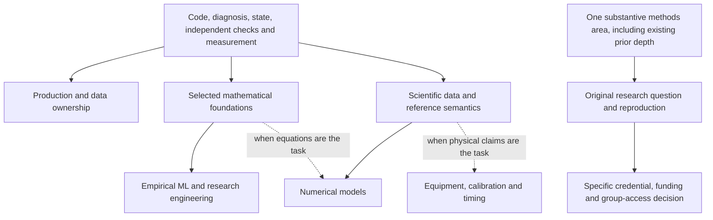

# Preparation pathways: shared foundations, four conditional routes

Prepared 20 October 2026 from the existing research. Companion: `preparation-dependencies-round8.json`. No diagnostic, implementation, installation, model/data fetch, user study or external action was performed. The frozen taxonomy and reports remain unchanged.

The practical choice is **one main depth area, with shared engineering foundations and a small adjacent capability**. The reader already identifies as an AI engineer; the research has not assessed his actual debugging, SQL, mathematical, ML or systems competence. It also has not established his degree, available hours, hardware, financial runway, work rights, relocation plans or preferred daily work. A beginner restart and an assumption of mastery would both be unjustified.

A useful first investment is **30–50 focused hours**, followed by **another 90–150 hours only if the probe remains worthwhile**. These are planning assumptions. At five hours per week, the combined 120–200 hours takes roughly 24–40 weeks; at ten hours, 12–20 weeks. It is not automatically a 30/90-day programme, a complete degree or a promise of job readiness. The four routes below are alternatives rather than four simultaneous projects.

## What actually transfers—and what does not

| Foundation | Evidence of depth | Why it transfers | Add only when the branch needs it |
|---|---|---|---|
| Read/change programs and diagnose failures | Explain the real dataflow, predict a violated invariant, collect evidence that distinguishes causes, fix the same path and handle a new variant | Services, model pipelines, instrument adapters and research implementations all fail in concrete ways | A particular framework, C++, compiler internals or CUDA |
| Identity, state, time and provenance | Trace an accepted output to source/version; handle duplicates, revisions, unknown values and units | Enterprise records, laboratory data, legal documents, telemetry and training datasets share these problems | Deep SQL/planner work, a particular LIMS/EHR or domain schema |
| Runtime and partial failure | Reason about memory/I/O, ordering, retries, backpressure, cancellation and the point of commit | Useful work runs under finite resources and imperfect dependencies | Consensus internals, real-time firmware, multi-GPU execution |
| Independent correctness evidence | Audit the actor and the oracle; demonstrate accepted-wrong and rejected-correct cases | A convincing output is insufficient across all four routes | A theorem prover, physical reference campaign or professional adjudication |
| Measurement and experimental judgment | Match conditions, retain failed/incomplete attempts and total effort, use the right holdout/dependence unit, explain uncertainty | Product decisions, ML comparisons and scientific claims need interpretable evidence | Advanced causal inference, specialised uncertainty methods or a new benchmark |
| Workflow, authority and collaboration | Name the actual decision/owner/error consequence; keep permissions and effects aligned; explain trade-offs and hand over the system | Real ownership includes other people and operational constraints | Domain credentials, procurement expertise or professional responsibility specific to the role |

This is a dependency map, not a claim that these tasks remain immune to automation. Stronger tools may also perform diagnosis, evaluation and integration. Their value has to be demonstrated against mature/native alternatives. The [software analysis](<software.md>), [systems projects](<systems-round2.md>) and [independent actionability review](<actionability-review-round4.md>) support this approach; none estimates the future wage premium for each skill.

The map has 17 modules. Its arrows describe what must be understood before claiming a particular depth—not what the learner necessarily lacks. Optional native/GPU work is deliberately separate. Research design requires depth in **one** substantive methods area, rather than all of production engineering, ML, physics and hardware.

The official-resource worker owns `learning-resources-round8.json`: exact sections/exercises, access/terms, prerequisites and small optional slices. This companion owns the routes and dependencies. A course catalogue is a menu of resources, not another requirement to finish everything. Existing approved tools are enough to begin some diagnostics; missing packages, weights or hardware are explicit later gates.

## Diagnose with fresh tasks before choosing the learning load

Use a small common diagnostic and one branch probe. If undecided, compare two brief probes within the same budget. Do not turn the first week into a survey of every discipline.

The **task setter and answer-key maintainer should be separate from the learner**. Use an independently sourced exercise whose solution is unseen, or later authorised local preparation by a separate setter. The reader should not write or hand-check the final test keys and then call the resulting assessment unfamiliar. A hidden scorer can itself be wrong: audit it against a mature reference or independently derived tiny case before sealing the task. This directly incorporates the [learning-exposure review](<methods-review-round6-human-domains.md>).

Five proposed diagnostics are defined in the JSON:

1. **Fresh failure:** predict the invariant in an unfamiliar small worker/service, diagnose and repair it, then handle a different failure configuration after a week. A plausible assistant explanation is not the acceptance oracle.
2. **Data/time meaning:** find the correct record given duplicates, a late revision, a unit mismatch, missing values and a tenant boundary. Trace source to accepted state.
3. **ML validity:** predict a simple model/loss behaviour, identify a group/time/preprocessing leak and choose a valid comparison. A higher leaked score is a useful negative example.
4. **Scientific oracle:** choose one volume/resource, force/unit/reference or mechanistic-solver case. Explain why software consistency differs from independent physical truth.
5. **Research contract:** analyse an unfamiliar methods/result slice, define a tractable falsifier and choose a valid reference before proposing an improvement.

Begin with an unaided prediction/explanation, then allow the usual approved assistance for the implementation phase. Record the assistance. A later structurally new task tests transfer; repeating the same solved task mainly tests familiarity. Log intervening practice and exposure. These are local diagnostics, not a powered learning trial, an employer assessment or proof that assisted learning is inferior. The existing research includes positive independent learning outcomes and does not establish universal long-term deskilling.

## Four competing routes

### A. Production, data and systems ownership

Choose this if the attractive work is making useful services dependable: changing records, permissions, queues, compatibility, recovery and the real receiving workflow. Advanced model training is optional. Native systems depth can become a later speciality when profiling or the target role justifies it.

**First 30–50 hours:** 4–6 hours on fresh diagnosis and the task contract; 8–12 closing one evidenced gap; 12–20 reproducing one mature workflow baseline; 6–12 on a new failure/source family, complete effort accounting and a handoff. Skip redundant beginner instruction when the diagnostic supports doing so.

**Next 90–150 hours:** choose one queue/reconciliation or version-aware importer improvement. Freeze a baseline and independent state/field oracle, implement one justified change, then test a later source family, permission change, duplicate/crash condition and a regime where it loses. Preserve all failed effort. A process restart test is not a power-loss durability test; cancellation is not rollback; an outbox does not create universal exactly-once external effects.

The sampled [LabVantage development role](https://www.labvantage.com/wp-content/uploads/2026/08/Software-Engineer_Development_June-2026.pdf) illustrates ordinary Java/SQL/product work with a CS-related degree and three years’ experience. The [Speechmatics frontend role](https://job-boards.eu.greenhouse.io/speechmatics/jobs/4987568101) illustrates a different product route with shipped UI/testing/iteration and London restrictions. These examples do not require learning both stacks or establish future vacancy availability.

**Redirect evidence:** the mature/native baseline already solves the task at lower complete cost; the chosen workflow has no repeated owner/budget; or diagnosis remains weak because architecture was added before understanding the failure. The skills can still be useful even when a standalone product is rejected.

**Opportunity cost:** operating integrations can displace time for mathematical/model research. Bespoke integration may also carry substantial support work and weak product margins. That is a trade-off to choose, not a reason to rank this route below research.

### B. ML and research engineering

Choose this if implementing and explaining model behaviour, data quality, experimental comparison and failures is rewarding. Add the mathematics needed for the chosen loss, representation and uncertainty question. Do not postpone every small model exercise until an entire maths curriculum is finished.

**First 30–50 hours:** 4–6 on a fresh mathematical/model-validity diagnostic; 12–20 on targeted maths and a strong simple baseline; 8–14 matching one feasible existing experiment slice; 6–10 on leakage, uncertainty and failure analysis. A classical or existing pretrained model winning is an informative result.

**Next 90–150 hours:** reproduce a version-matched baseline, diagnose one limitation, change one data/model/calibration mechanism and test an untouched group/time/source condition at a fixed budget. Alternatively, choose a fixed inference bottleneck if serving is the real interest; this is a different depth from inventing a learning method. Include quality, queueing/preprocessing and complete cost, with an explicit load process.

The sampled [Isomorphic research-engineer role](https://job-boards.greenhouse.io/isomorphiclabs/jobs/5578430004) accepts an advanced degree **or equivalent practical experience**, while asking for substantial real ML work and London attendance. That differs from its staff platform or scientist screens. A PTB-XL project can demonstrate transferable ML evaluation; it is not evidence that Isomorphic has an ECG team, clinical validation or staff GPU-platform readiness. [Round 7 repair proposals](<science-metadata-repairs-round7.md>) preserve this edge meaning.

**Redirect evidence:** no lawful/feasible data/runtime path; repeated test tuning; the proposed improvement disappears against matched simple/pretrained baselines; or mathematical/experimental iteration is persistently unappealing. A smaller CPU baseline is a legitimate start; a CPU exercise cannot certify CUDA or multi-node competence.

**Opportunity cost:** many experiments produce negative or ambiguous results and little immediate customer ownership. Stronger pretrained models can remove a narrow feature/model advantage. Preserve systems and data depth alongside the speciality.

### C. Physical/scientific software in one bounded domain

Choose this if quantities, instruments, simulation or scientific data are interesting, while accepting that software, scientific validity and physical deployment have different oracles. A scientific importer does not require learning all biology; an atomistic method claim does require substantially more domain training than a schema adapter.

**First 30–50 hours:** 4–6 on a fresh units/state/reference diagnostic; 8–12 on the selected domain’s measurement fundamentals; 12–20 reproducing a mature validator/simulator/reference slice; 6–12 on an independent counterexample, fault and proof-boundary account.

**Next 90–150 hours:** choose **one** scientific-data gateway, lab-runner, existing-DFT artifact audit or PyBaMM solver/event regression. The route must have an independent oracle: mature schema plus an independently expected unit/conflict case; independent volume/conservation ledger; matching published DFT reference; or an analytical/convergence result. Add the equations/numerics branch only if that is the question. Add real device timing/calibration only when authorised equipment/operator access is available.

The [Toronto hardware-specialist role](https://jobs.utoronto.ca/job/Toronto-Hardware-Technical-Specialist-(100-Onsite,-Two-year-term)-ON/606519117/) demonstrates an engineering route with degree/equivalent, hands-on experience, onsite work and a grant term. [PyBaMM contribution channels](https://pybamm.org/contribute/) demonstrate a public numerical-software route; contribution access is not paid employment or guaranteed acceptance. The [science review](<methods-review-round6-science-earth.md>) and [metadata repairs](<science-metadata-repairs-round7.md>) keep checkpoint/data rights, corrected snapshots, unrelaxed inputs and equal physical simulation durations explicit.

**Redirect evidence:** essential physical/reference data or domain review cannot be obtained; the existing vendor/framework covers the proposed gap; or the subject is unattractive after the probe. Retain the permitted software/reference audit rather than claiming physical performance. Public healthy-participant decoding, valid simulation and self-conservation do not establish patient benefit, safe equipment or a useful new material.

**Opportunity cost:** domain learning, onsite access and slower experimental cycles can reduce flexibility. Public scientific contributions may remain unpaid. More generated candidates or better science does not automatically mean more accessible software jobs.

### D. Research-method and conditional credential route

Choose this if new questions, methods reading and ambiguous/negative results are intrinsically rewarding, and a concrete target requires a doctorate/equivalent research record or access to substantial supervised training. This route is conditional; it is not the universal next rung above engineering.

**First 30–50 hours:** 6–8 on a fresh research contract; 8–14 on the exact method/reference and prerequisites; 10–18 designing or reproducing one small available-artifact slice; 6–10 comparing actual credential, location, funding and opportunity-cost conditions with an engineering alternative. No application or contact is implied.

**Next 90–150 hours:** close one selected methods gap, reproduce a narrow reference, conduct one prespecified ablation/extension and write an independently reviewable result account. A valid null/negative finding or important corrected evaluator can be useful. This period helps decide whether further research investment is warranted; it does not confer scientific independence or replace years of specialist training.

The sampled [Toronto staff-scientist role](https://jobs.utoronto.ca/job/Toronto-Staff-Scientist-%28AI-for-Self-Driving-Labs%29-ON/606764217/) asks for a PhD/equivalent, publications and substantial experience. Isomorphic’s scientist wording and application filter also make credentials consequential. Conversely, the research-engineering and product examples above do not impose one universal doctorate requirement. Exact programme admissions, current funded places, fees, work rights and supervision need their own later verification. None has been secured.

**Redirect evidence:** unavailable funding/admission/access; an unreviewable scientific oracle; a preference for production outcomes over research iteration; or no demonstrated benefit from the proposed credential compared with a viable engineering route. A blocked access gate is not proof of inability.

**Opportunity cost:** potentially years of study and foregone income, with actual funding/returns still unknown. Publication incentives and narrow specialisation may diverge from useful product work. Keep implementation and measurement competence.

## What advancement would actually have to show

| Horizon | Production/data | ML/research engineering | Scientific/physical software | Research/credential |
|---|---|---|---|---|
| Year 1 | One maintained subsystem; fresh failure diagnosis; useful defect/integration/compatibility contribution | One well-explained reproducible model/evaluation pipeline; honest failures and mathematical understanding | One scientific-data/adapter/reference artifact; quantities and proof boundaries reviewed where possible | One rigorous reproduction/critique and an informed training/access decision |
| Years 2–3 | Ownership across releases/incidents; independent adoption; mentor another engineer | Ownership through data/model changes; others reproduce or use contributions | Real version/calibration/reference changes handled; uptake; physical transfer measured only if access exists | Within actual access, a scrutinised methods record, collaborations and independent replication |
| Years 4–5 | Consequential architecture/delivery decisions; others can operate the system without its original author | Sound model/data/compute decisions and a sustained body of useful work | Cross-domain software/science decisions, reliable measurement practice and others trained to challenge it | Original independently scrutinised work, mentoring and sustained institutional/community uptake |

These are evidence gates, not timed promotions. An original contribution can be a previously missed failure, a better adapter, a useful validated workflow or a new research result; its claim should match its evidence. Research publication, repository popularity, a degree and business revenue are different achievements. Leadership includes raising other people’s judgment and the system’s maintainability, not only personal output.

The shared base preserves movement between routes: production → ML adds model/math/evaluation depth; ML → science adds the domain’s units/reference/measurement rules; science → production adds the customer/operations context; research → engineering adds sustained delivery and operational ownership. None requires discarding the depth already demonstrated.

The source role samples were inspected around 19 October and may close before any preparation cycle ends. They describe work and access filters, not a current application shortlist or 2031 headcount forecast. The [correction register](<corrections.json>) prevents occupational exposure/adoption studies and small learning experiments from becoming personal career predictions. Root’s separate selection policy can combine these pathways with the still-unknown personal constraints; this artifact does not force a winner.
